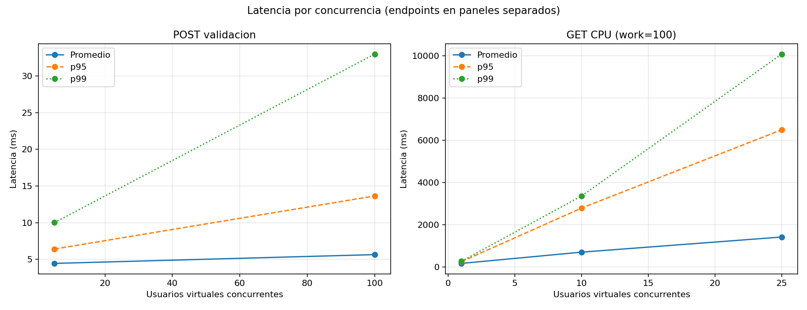
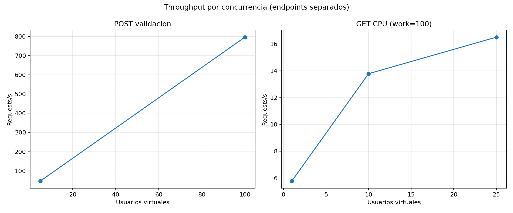
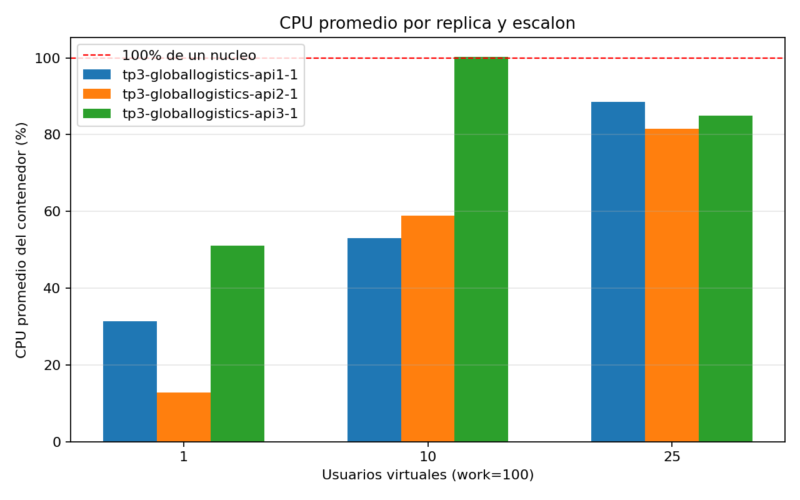
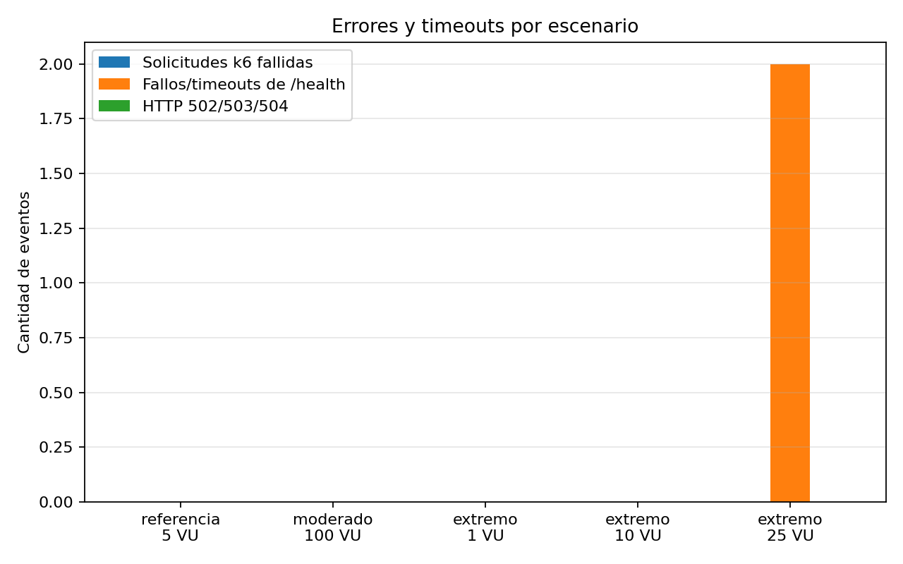
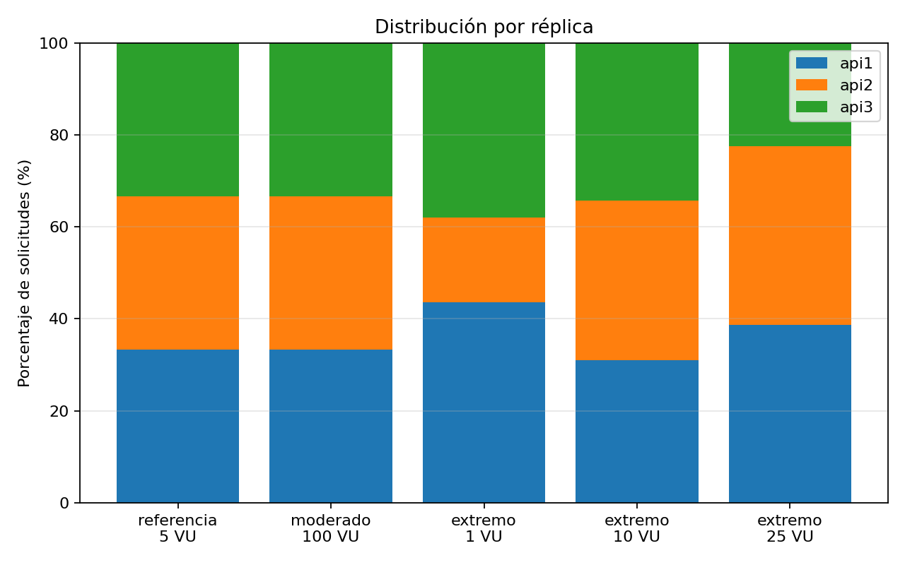

# Reporte de rendimiento — etapa Rivamar

**TP3 GlobalLogistics · Universidad Champagnat · 2026**  
Repositorio: https://github.com/LozanoSh/TP3-GlobalLogistics  
**Estado:** mediciones de referencia, 100 VU y CPU a 1, 10 y 25 VU completadas el 30/10/2026.

## Objetivo y alcance

Medir, a través de Nginx, el comportamiento de las tres réplicas fijas con dos tipos de carga: validación de solicitudes de Gestión de Envíos y cálculo sintético intensivo de CPU. Se registran solicitudes, throughput, latencia promedio, p95, p99 y máxima, errores, distribución por instancia, CPU, memoria y salud.

`POST /envios/validar` valida el contrato y devuelve un resumen, pero no crea ni persiste el envío. Estas mediciones no prueban la operación completa `POST /envios/crear` del TP2, que requiere autenticación, idempotencia, persistencia, transacción y outbox.

## Arquitectura y entorno

Un Nginx publicado en `localhost:8080` distribuye solicitudes round-robin a `api1`, `api2` y `api3`. Compose define exactamente cuatro servicios principales. Cada API corre Node.js/Express en un contenedor; las réplicas son fijas, sin autoescalado. Nginx es un punto único de entrada.

| Elemento | Entorno medido |
|---|---|
| Equipo | Lenovo modelo 82KT, 16 procesadores lógicos, 10.592.444.416 bytes de RAM física |
| Host | Windows x64; cliente local y Docker Desktop |
| Node.js / npm | 24.15.0 / 11.12.1 en el host; imagen del servicio Node.js 22 |
| Docker Engine / Compose | 29.7.2 / 5.4.0 |
| k6 | 2.3.0 |
| Configuración | Cuatro contenedores healthy antes de la carga; entrada por `http://localhost:8080` |

## Herramienta y metodología

Se ejecutó k6 con `tests/run_stress.ps1`. La referencia de validación usó 5 VU durante 30 s; el moderado subió gradualmente a 100 VU y los mantuvo 45 s. La serie de CPU usó `GET /api/cpu?work=100` con 1, 10 y 25 VU durante 30 s cada una. `work=100` se mantuvo fijo para comparar concurrencia.

El runner conservó el resumen y los puntos k6, muestras de `docker stats`, solicitudes auxiliares de `/health`, `/nginx-health` e identidad por réplica, y metadatos. Los archivos originales están en `tests/results/20261030_*`. La prueba de 25 VU se detuvo en ese escalón porque se observaron timeouts de salud y latencias de hasta 11,62 s; no se extrapolan resultados a 50 VU o más.

## Resultados

Las latencias se miden desde el host hasta Nginx y la API. Los escenarios de validación y CPU se mantienen separados porque son endpoints y trabajos distintos.

| Escenario | Endpoint | VU | work | Requests | req/s | Promedio ms | p95 ms | p99 ms | Máxima ms | Errores k6 |
|---|---|---:|---:|---:|---:|---:|---:|---:|---:|---:|
| Referencia | `POST /envios/validar` | 5 | — | 1.425 | 47,34 | 4,45 | 6,40 | 10,01 | 33,36 | 0 % |
| Moderado | `POST /envios/validar` | 100 | — | 51.807 | 796,02 | 5,64 | 13,64 | 32,98 | 131,09 | 0 % |
| CPU liviano | `GET /api/cpu` | 1 | 100 | 174 | 5,79 | 171,98 | 255,00 | 273,42 | 288,42 | 0 % |
| CPU alto | `GET /api/cpu` | 10 | 100 | 438 | 13,78 | 704,30 | 2.792,49 | 3.363,93 | 6.470,15 | 0 % |
| CPU extremo medido | `GET /api/cpu` | 25 | 100 | 553 | 16,51 | 1.421,45 | 6.499,47 | 10.084,81 | 11.621,87 | 0 % |

En la prueba de 100 VU se observaron 100 VU máximos, 100 % de checks aprobados y ninguna respuesta HTTP fallida. En los escenarios CPU, k6 también registró cero solicitudes fallidas, aunque la salud se deterioró: la solicitud CPU podía esperar en la cola del event loop sin producir un error HTTP.

### CPU y memoria por réplica

CPU promedio y pico observados en las muestras de `docker stats` durante las corridas CPU:

| VU (`work=100`) | api1 promedio / pico | api2 promedio / pico | api3 promedio / pico |
|---:|---:|---:|---:|
| 1 | 31,3 % / 42,31 % | 12,8 % / 29,41 % | 51,1 % / 68,19 % |
| 10 | 53,1 % / 99,50 % | 58,9 % / 96,20 % | 100,3 % / 104,31 % |
| 25 | 88,6 % / 102,05 % | 81,5 % / 100,12 % | 85,0 % / 102,39 % |

Los picos por encima de 100 % son lecturas de Docker del contenedor durante el intervalo; indican ocupación aproximada de un núcleo o más en ese punto de muestreo, no que un proceso Node.js haya obtenido capacidad ilimitada. La memoria máxima observada fue de aproximadamente 21,5–58,1 MiB por API, muy por debajo de la memoria disponible para Docker; el recurso que mostró presión fue CPU.

### Salud y reparto

| VU CPU | Muestras `/health` | No 200 / timeout | Muestras >1 s | Máxima demora `/health` |
|---:|---:|---:|---:|---:|
| 1 | 30 | 0 | 0 | 75,44 ms |
| 10 | 21 | 0 | 5 | 2.709,64 ms |
| 25 | 15 | 2 | 5 | 4.034,41 ms |

En el escalón de 25 VU, los dos probes fallidos agotaron el límite de 4 s del muestreador. Al finalizar, `docker compose ps` volvió a mostrar los cuatro servicios como healthy. Las respuestas de carga y el registro de instancias confirmaron que las tres réplicas atendieron solicitudes. La distribución round-robin fue observable, aunque las solicitudes CPU no quedan uniformes por instancia en una ventana corta porque el tiempo de respuesta del event loop altera el ritmo de llegada.

## Gráficos

Se generaron desde `k6_summary.json`, `k6_metrics.json.gz` (copia comprimida de los puntos crudos), `docker_stats.csv`, `health.csv` y `metadata.json` de las corridas citadas. La tabla consolidada `tests/results/resumen_escenarios.csv` conserva las cifras empleadas. La latencia y el throughput separan los endpoints para evitar comparaciones engañosas.

## Punto de degradación y análisis

Para `/api/cpu?work=100`, se considera degradación clara cuando p95 supera al menos dos veces la referencia de 1 VU y aparece además una elevación fuerte de p99, presión de CPU o demora/fallo del health check. El primer escalón que cumple el criterio es **10 VU**: p95 subió de 255 ms a 2.792 ms (10,95 veces) y p99 de 273 ms a 3.364 ms (12,30 veces). Una réplica alcanzó 104,31 % de CPU muestreada y cinco probes de 21 tardaron más de un segundo.

A 25 VU, el throughput siguió creciendo de 13,78 a 16,51 req/s, pero p95 llegó a 6,50 s y p99 a 10,08 s; la máxima fue 11,62 s. Dos probes de salud agotaron el timeout y las tres réplicas registraron picos cercanos o superiores a 100 % de CPU. El throughput adicional no compensa ese aumento de latencia de cola.

El trabajo de CPU se ejecuta sincrónicamente en el hilo principal de Node.js. Mientras una réplica calcula, las solicitudes posteriores, incluido `/health`, esperan en su event loop. Nginx continuó enviando las respuestas de `/api/cpu` como HTTP 200; no reintenta los timeouts de esa ruta para evitar duplicar el trabajo. Para `/envios/validar`, Nginx no reintenta el POST.

Tres réplicas no garantizan latencia constante: comparten recursos finitos y cada proceso Node tiene un hilo principal que procesa una operación síncrona a la vez. Tres réplicas fijas tampoco equivalen a autoescalado; no hay un controlador que agregue instancias. Un Nginx único sigue siendo punto de falla. En producción se evaluarían worker threads o una cola para CPU, límites y reservas, escalado con métricas, probes no bloqueantes, redundancia del balanceador y observabilidad.

## Restricciones temporales y conclusión

La máxima del escenario moderado de validación fue 131,09 ms. Para `/api/cpu`, la máxima fue 288,42 ms a 1 VU, 6.470,15 ms a 10 VU y 11.621,87 ms a 25 VU. Por tanto, la máxima observada supera la referencia de 1.000 ms desde 10 VU en el endpoint sintético de CPU.

Los objetivos p95 ≤ 250 ms, p99 ≤ 500 ms y máximo ≤ 1.000 ms fueron planteados para la operación completa `POST /envios/crear` del TP2. `POST /envios/validar` no realiza autenticación, idempotencia, persistencia, transacción ni outbox; estos resultados no permiten afirmar que la operación transaccional cumpla o incumpla su SLA. Sí muestran que la API técnica se degrada bajo CPU antes de devolver errores HTTP y que la latencia máxima no permanece bajo 1 s durante saturación.

## Evidencias y reproducción

- Referencia POST 5 VU: `tests/results/20261030_195150_referencia_5vus_work100/`.
- Moderado POST 100 VU: `tests/results/20261030_201228_moderado_100vus_work100/`.
- CPU 1, 10 y 25 VU: `tests/results/20261030_202522_extremo_1vus_work100/`, `tests/results/20261030_201849_extremo_10vus_work100/` y `tests/results/20261030_202917_extremo_25vus_work100/`.
- Runner y scripts k6: [`tests/run_stress.ps1`](../tests/run_stress.ps1), [`tests/k6_escenario_referencia.js`](../tests/k6_escenario_referencia.js), [`tests/k6_escenario_moderado.js`](../tests/k6_escenario_moderado.js), [`tests/k6_escenario_extremo.js`](../tests/k6_escenario_extremo.js).
- Generación de gráficos: `python tests/graficar_resultados.py --runs <carpetas>`.
- Los registros completos, capturas de terminal y CSV originales se conservan en las carpetas de resultados; las imágenes de consola son evidencia complementaria.
- Para evitar el límite de tamaño de GitHub, se pueden versionar `k6_metrics.json.gz` en vez del JSON crudo sin comprimir; el generador acepta ambos formatos.

Capturas auténticas de la ejecución:

- [Build de Compose](../evidencias/captura_rivamar_build.png), [cuatro contenedores healthy](../evidencias/captura_rivamar_contenedores.png), [validación de Envíos](../evidencias/captura_rivamar_validacion_envios.png) y [28 pruebas unitarias](../evidencias/captura_rivamar_npm_test_1.png), [continuación](../evidencias/captura_rivamar_npm_test_2.png).
- [Resumen referencia 5 VU](../evidencias/captura_referencia_5vu_resumen.png) y [cierre de la corrida moderada de 100 VU](../evidencias/captura_moderado_100vu_resultado.png).
- CPU `work=100`: [1 VU resumen](../evidencias/captura_cpu_1vu_work100_resumen.png), [1 VU archivos](../evidencias/captura_cpu_1vu_work100_resultado.png), [10 VU resumen](../evidencias/captura_cpu_10vu_work100_resumen.png), [10 VU archivos](../evidencias/captura_cpu_10vu_work100_resultado.png), [25 VU resumen](../evidencias/captura_cpu_25vu_work100_resumen.png), [25 VU archivos](../evidencias/captura_cpu_25vu_work100_resultado.png).
